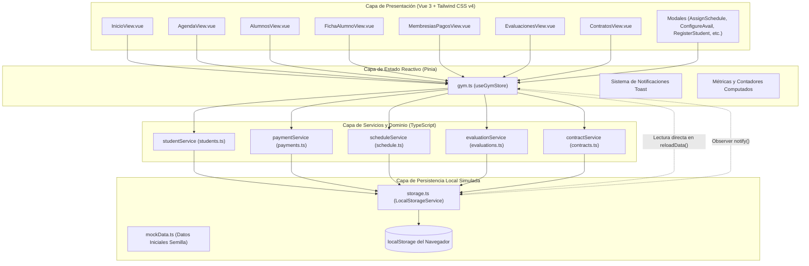
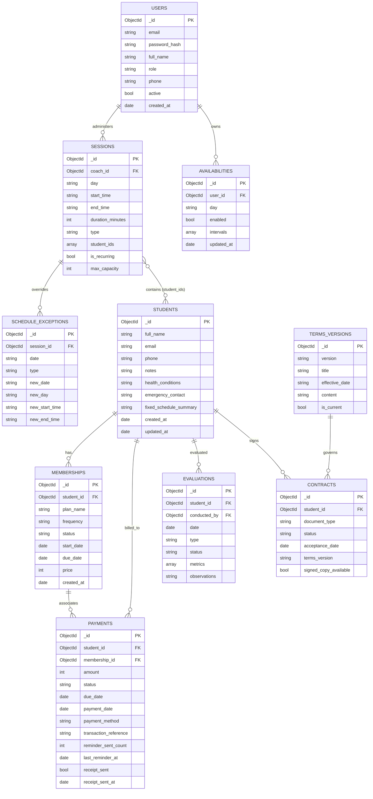
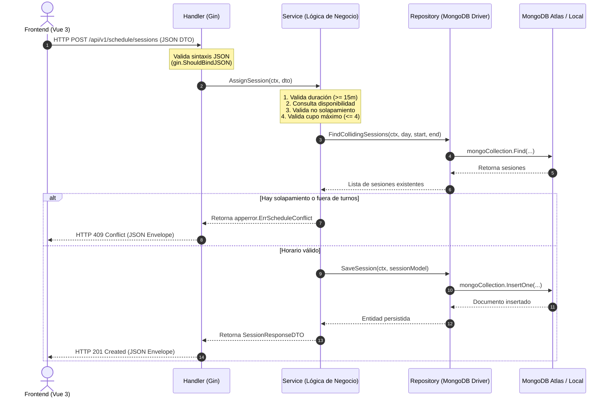
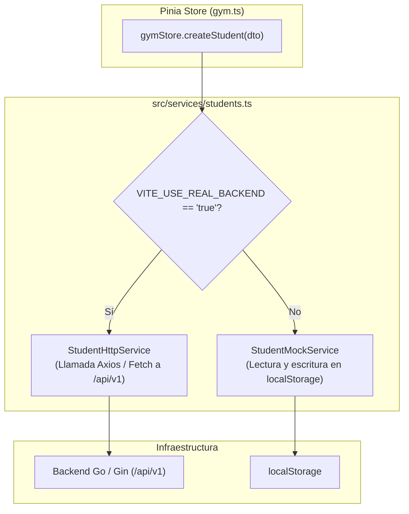
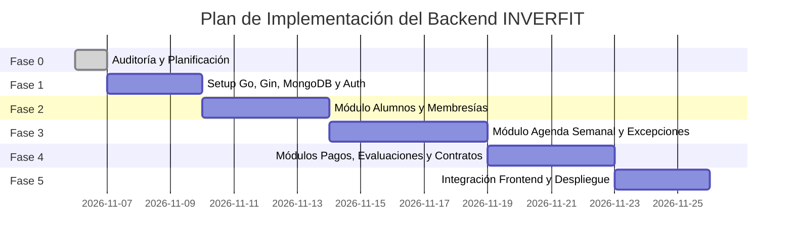

# PLAN DE IMPLEMENTACIÓN DEL BACKEND EN GO Y MONGODB — PLATAFORMA INVERFIT

**Documento:** Auditoría Técnica de Frontend y Planificación Arquitectónica de Backend
**Fecha:** Noviembre 2026
**Versión:** 1.0.0 (Fase 0 — Auditoría y Planificación)
**Proyecto:** INVERFIT (Centro de Entrenamiento Personalizado y Grupal)
**Autor:** Equipo de Arquitectura e Ingeniería de Software

---

## 1. Resumen Ejecutivo

El presente documento constituye la auditoría técnica exhaustiva del frontend de **INVERFIT** y la planificación arquitectónica formal para la construcción de su backend en **Go (Gin)** con base de datos **MongoDB**.

Actualmente, INVERFIT cuenta con un prototipo frontend de alta fidelidad desarrollado en **Vue 3 (Composition API), TypeScript, Pinia, Tailwind CSS v4 y Vite**, desplegado en **Cloudflare Pages**. La aplicación cubre siete módulos funcionales:
1. Inicio (Dashboard operativo y KPIs).
2. Agenda semanal (Gestión de disponibilidad flexible y programación de bloques).
3. Alumnos (Maestro de alumnos con filtros y altas).
4. Ficha del alumno (Vista 360° con 5 pestañas de detalle).
5. Membresías y pagos (Seguimiento de cobros, simulaciones y exportación CSV).
6. Evaluaciones físicas (Métricas dinámicas y seguimiento de progreso).
7. Contratos y consentimientos (Versionado legal y simulación de firmas).

Toda la persistencia reside hoy en una capa desacoplada en cliente sobre `localStorage` con emisor de eventos reactivos (`LocalStorageService`). Las reglas de negocio, los cálculos de tiempo y solapamiento, las cascadas referenciales y las simulaciones externas se ejecutan en el navegador.

El objetivo de esta **Fase 0** es auditar el código fuente real, evaluar las reglas de negocio implementadas frente a las directrices acordadas, diseñar la estrategia de datos en MongoDB, modelar los contratos de API REST (`/api/v1`) y planificar la arquitectura en Go bajo un enfoque **monolítico modular por capas**, garantizando una migración gradual sin disrupciones para el frontend.

---

## 2. Estado Actual del Frontend

### 2.1. Inventario de Componentes y Vistas Inspeccionadas

La inspección del repositorio comprendió el 100% de los módulos y capas del sistema:

| Directorio | Archivos Clave | Rol y Responsabilidad |
|---|---|---|
| `src/types/` | `student.ts`, `payment.ts`, `schedule.ts`, `evaluation.ts`, `contract.ts`, `index.ts` | Modelos de dominio e interfaces TypeScript con tipado estricto. |
| `src/services/` | `storage.ts`, `mockData.ts`, `students.ts`, `payments.ts`, `schedule.ts`, `evaluations.ts`, `contracts.ts`, `index.ts` | Capa de lógica de negocio, validaciones y abstracción de persistencia local. |
| `src/stores/` | `gym.ts` | Store global en Pinia: métricas reactivas calculadas, orquestación de llamadas y notificaciones Toast. |
| `src/views/` | `InicioView.vue`, `AgendaView.vue`, `AlumnosView.vue`, `FichaAlumnoView.vue`, `MembresiasPagosView.vue`, `EvaluacionesView.vue`, `ContratosView.vue` | Las 7 pantallas de usuario coincidentes con los wireframes de Figma. |
| `src/components/modals/` | `AssignScheduleModal.vue`, `BlockDetailsModal.vue`, `ConfigureAvailabilityModal.vue`, `RegisterStudentModal.vue`, `RegisterPaymentModal.vue`, `CreateEvaluationModal.vue`, `ManageTermsModal.vue`, `SimulatedActionModal.vue` | Modales interactivos de captura, edición y simulación de operaciones. |
| `src/router/` | `index.ts` | Enrutamiento SPA basado en `createWebHistory` con metadatos de título dinámicos. |
| `docs/` & Raíz | `FUNCIONALIDADES_IMPLEMENTADAS.md`, `README.md`, `package.json`, `vite.config.ts` | Especificación funcional previa, dependencias y scripts de empaquetado. |

### 2.2. Mecanismos de Persistencia y Reactividad Actual

La persistencia en el prototipo se implementa mediante la clase singleton `LocalStorageService` en `src/services/storage.ts`. Utiliza 8 claves principales de almacenamiento:

1. `inverfit_students_v1`: Arreglo serializado de `Student`.
2. `inverfit_payments_v1`: Arreglo serializado de `Payment`.
3. `inverfit_schedule_v1`: Arreglo serializado de `ScheduleBlock`.
4. `inverfit_availability_v1`: Arreglo serializado de `DayAvailability`.
5. `inverfit_schedule_exceptions_v1`: Arreglo serializado de `ScheduleException`.
6. `inverfit_evaluations_v1`: Arreglo serializado de `Evaluation`.
7. `inverfit_contracts_v1`: Arreglo serializado de `ContractConsent`.
8. `inverfit_terms_v1`: Arreglo serializado de `TermsVersion`.

El servicio implementa un **patrón Observer** (`listeners: Set<() => void>`). Al invocarse cualquier mutación (`storage.set(...)`), se ejecutan las suscripciones registradas. En `src/stores/gym.ts`, Pinia mantiene una suscripción activa (`storage.subscribe(() => reloadData())`), lo que actualiza de forma síncrona el estado de la aplicación.

### 2.3. Acoplamiento de Vistas y Componentes respecto a `localStorage`

Uno de los hallazgos críticos de la auditoría es determinar el nivel real de acoplamiento de las vistas hacia `localStorage`:

- **Vistas y Modales:** **No acceden directamente a `window.localStorage` ni a `storage.ts`**. Las vistas delegan sus mutaciones exclusivamente en las acciones del store `useGymStore()` o en funciones utilitarias de cálculo de fecha/hora exportadas por `schedule.ts`.
- **Excepciones encontradas:**
  - `MembresiasPagosView.vue` importa directamente `paymentService` para invocar el método utilitario de memoria `paymentService.exportToCSV()`.
  - `AssignScheduleModal.vue` importa `scheduleService` para ejecutar la validación reactiva en cliente `scheduleService.validateSession()`.
  - `ManageTermsModal.vue` importa `contractService` para consultar la versión vigente.
  - El store `gym.ts` en su método `reloadData()` realiza llamadas directas a `storage.getStudents()`, `storage.getPayments()`, etc., en lugar de invocar los métodos asíncronos de `studentService.getAll()`, `paymentService.getAll()`, etc.

> [!NOTE]
> La separación vista-store es limpia. El principal acoplamiento que debe refactorizarse durante la integración es hacer que `gym.ts` consuma los métodos asíncronos de la capa de servicios, permitiendo que estos pasen de consultar `storage.ts` a consumir los endpoints HTTP de la API REST en Go.

---

## 3. Arquitectura Actual del Prototipo



### 3.1. Flujo de Datos y Cascada de Operaciones en Frontend

Actualmente, ante la ausencia de un backend transaccional, el frontend asume la responsabilidad de coordinar mutaciones en cascada entre entidades no relacionadas directamente:

1. **Alta de Alumno:** Al ejecutar `studentService.create(dto)`:
   - Se crea el registro del alumno en `inverfit_students_v1`.
   - Se genera de inmediato un registro de pago con estado `"Pendiente"` en `inverfit_payments_v1`.
   - Se crea una evaluación inicial con estado `"Pendiente"` en `inverfit_evaluations_v1`.
   - Se crea un documento contractual de términos con estado `"Pendiente"` en `inverfit_contracts_v1`.
2. **Actualización de Nombre del Alumno:** Al modificar `fullName`, el servicio actualiza en memoria el campo desnormalizado `studentName` en los arreglos de pagos, contratos y evaluaciones.
3. **Eliminación de Alumno:** Al eliminar un alumno, el frontend elimina en cascada sus pagos, evaluaciones y contratos asociados, y retira su identificador de cualquier `studentIds` dentro de los bloques de agenda.
4. **Registro de Pago:** Si el alumno asociado tiene estado `"Por revisar"`, el servicio de pagos actualiza directamente la entidad del alumno a `"Activo"`.
5. **Asignación a Agenda:** Al guardar una sesión, el servicio recalcula el string de resumen `fixedSchedule` de todos los alumnos participantes (ej. `"Lun 06:30, Mié 06:30"`) y lo persiste en `inverfit_students_v1`.

---

## 4. Inventario de Entidades y Modelos TypeScript

### 4.1. Análisis Detallado de Entidades

#### 1. Alumno (`Student`)
- **Archivo:** `src/types/student.ts`
- **Atributos:**
  - `id`: `string` (ej. `"alu-01"`, `"alu-02-1234"`).
  - `fullName`: `string` (obligatorio).
  - `email`: `string` (obligatorio en entidad, generado automáticamente en DTO).
  - `phone`: `string` (obligatorio en entidad).
  - `planName`: `string` (por defecto `"Plan estándar"`).
  - `frequency`: `FrequencyType` (`'1 vez/sem.' | '2 veces/sem.' | '3 veces/sem.' | '4 veces/sem.'`).
  - `membershipStatus`: `StudentStatus` (`'Activo' | 'Por revisar' | 'Inactivo'`).
  - `fixedSchedule`: `string` (cadena calculada o manual, ej. `"Lun y Mié 06:30"`).
  - `membershipStartDate`: `string` (`"YYYY-MM-DD"` o `"Por registrar"`).
  - `membershipDueDate`: `string` (`"YYYY-MM-DD"` o `"Por definir"`).
  - `notes`: `string` (opcional).
  - `healthConditions`: `string` (opcional, antecedentes médicos y lesiones).
  - `emergencyContact`: `string` (opcional, teléfono y relación de parentesco).
  - `createdAt`: `string` (`"YYYY-MM-DD"`).

#### 2. Pago (`Payment`)
- **Archivo:** `src/types/payment.ts`
- **Atributos:**
  - `id`: `string` (ej. `"pay-01"`, `"pay-882914"`).
  - `studentId`: `string` (referencia foránea hacia alumno).
  - `studentName`: `string` (campo desnormalizado para visualización rápida).
  - `planName`: `string` (desnormalizado).
  - `frequency`: `string` (desnormalizado).
  - `dueDate`: `string` (`"YYYY-MM-DD"` o `"Por definir"`).
  - `amount`: `number | null` (monto en CLP; `null` indica por definir).
  - `status`: `PaymentStatus` (`'Pagado' | 'Pendiente' | 'Por definir'`).
  - `paymentDate`: `string | null` (`"YYYY-MM-DD"` o `"Por registrar"`).
  - `paymentMethod`: `PaymentMethod` (`'Webpay' | 'Servipag' | 'Crédito' | 'Débito' | 'Transferencia' | 'Por definir'`).
  - `transactionReference`: `string` (opcional, ej. `"TRF-882914"`, `"BOL-202611-4921"`).
  - `reminderSentCount`: `number` (contador de recordatorios enviados).
  - `lastReminderAt`: `string | null` (marca temporal formateada).
  - `receiptSent`: `boolean` (bandera de emisión de boleta/comprobante).
  - `receiptSentAt`: `string | null` (marca temporal).
  - `notes`: `string` (opcional).

#### 3. Disponibilidad del Entrenador (`DayAvailability` e `AvailabilityInterval`)
- **Archivo:** `src/types/schedule.ts`
- **Atributos:**
  - `DayAvailability`:
    - `day`: `DayOfWeek` (`'Lun' | 'Mar' | 'Mié' | 'Jue' | 'Vie' | 'Sáb' | 'Dom'`).
    - `enabled`: `boolean` (indica si el gimnasio abre ese día).
    - `intervals`: `AvailabilityInterval[]` (arreglo de turnos).
  - `AvailabilityInterval`:
    - `id`: `string` (ej. `"int-lun-1"`).
    - `startTime`: `string` (`"HH:MM"`, ej. `"08:30"`).
    - `endTime`: `string` (`"HH:MM"`, ej. `"13:30"`).

#### 4. Bloque de Sesión de Agenda (`ScheduleBlock`)
- **Archivo:** `src/types/schedule.ts`
- **Atributos:**
  - `id`: `string` (ej. `"blk-lun-0630"`, `"blk-mie-0800"`).
  - `day`: `DayOfWeek`.
  - `startTime`: `string` (`"HH:MM"`).
  - `endTime`: `string` (`"HH:MM"`).
  - `durationMinutes`: `number` (calculado: `endTime - startTime`).
  - `type`: `'Sesión grupal' | 'Individual'` (dinámico según cantidad de alumnos).
  - `studentIds`: `string[]` (arreglo de IDs de alumnos asignados, cupo máximo recomendado: 4).
  - `isRecurring`: `boolean` (opcional, por defecto `true`).
  - `notes`: `string` (opcional).

#### 5. Excepción de Calendario (`ScheduleException`)
- **Archivo:** `src/types/schedule.ts`
- **Atributos:**
  - `id`: `string` (ej. `"exc-1730000000-abcd"`).
  - `originalBlockId`: `string` (referencia al `ScheduleBlock` afectado).
  - `date`: `string` (`"YYYY-MM-DD"`, fecha exacta afectada).
  - `type`: `'rescheduled' | 'cancelled'`.
  - `newDate`: `string` (opcional, `"YYYY-MM-DD"` si fue movida de fecha).
  - `newDay`: `DayOfWeek` (opcional, si cambió de día dentro de la semana).
  - `newStartTime`: `string` (opcional, `"HH:MM"`).
  - `newEndTime`: `string` (opcional, `"HH:MM"`).
  - `notes`: `string` (opcional).
  - `createdAt`: `string` (ISO timestamp).

#### 6. Ocurrencia de Sesión (`SessionOccurrence`)
- **Archivo:** `src/types/schedule.ts`
- **Naturaleza:** Entidad calculada en memoria para renderizado semanal. No es una entidad persistida directamente, sino el producto de combinar `ScheduleBlock` y `ScheduleException` contra un rango de 7 fechas.
- **Atributos:** `instanceId`, `blockId`, `day`, `date`, `startTime`, `endTime`, `durationMinutes`, `type`, `studentIds`, `isRecurring`, `isException`, `exceptionType`, `exceptionId`, `notes`.

#### 7. Evaluación Física (`Evaluation` y `EvaluationMetric`)
- **Archivo:** `src/types/evaluation.ts`
- **Atributos:**
  - `Evaluation`:
    - `id`: `string` (ej. `"eval-01"`).
    - `studentId`: `string` (referencia foránea).
    - `studentName`: `string` (desnormalizado).
    - `date`: `string` (`"YYYY-MM-DD"` o `"Por registrar"`).
    - `type`: `EvaluationType` (`'Evaluación inicial' | 'Seguimiento'`).
    - `status`: `EvaluationStatus` (`'Registrada' | 'Pendiente'`).
    - `metrics`: `EvaluationMetric[]` (esquema dinámico).
    - `observations`: `string`.
    - `conductedBy`: `string` (opcional, por defecto `"Pablo"`).
    - `createdAt`: `string` (`"YYYY-MM-DD"`).
  - `EvaluationMetric`:
    - `name`: `string` (ej. `"Peso corporal"`, `"Movilidad articular"`).
    - `value`: `string` (cuantitativo o cualitativo, ej. `"74.5"`, `"Buena"`).
    - `unit`: `string` (opcional, ej. `"kg"`, `"cm"`, `"reps"`).

#### 8. Contrato y Consentimiento (`ContractConsent`)
- **Archivo:** `src/types/contract.ts`
- **Atributos:**
  - `id`: `string` (ej. `"cnt-01"`).
  - `studentId`: `string` (referencia foránea).
  - `studentName`: `string` (desnormalizado).
  - `documentType`: `DocumentType` (`'Términos y condiciones' | 'Consentimiento informado' | 'Contrato de servicios'`).
  - `status`: `ContractStatus` (`'Aceptado' | 'Pendiente'`).
  - `date`: `string` (`"YYYY-MM-DD"` o `"Por registrar"`).
  - `termsVersion`: `string` (ej. `"v1.0 (2026)"`).
  - `signedCopyAvailable`: `boolean`.
  - `notes`: `string` (opcional).

#### 9. Versión de Términos Contractuales (`TermsVersion`)
- **Archivo:** `src/types/contract.ts`
- **Atributos:**
  - `version`: `string` (clave identificadora, ej. `"v1.0 (2026)"`).
  - `title`: `string`.
  - `effectiveDate`: `string` (ej. `"Octubre 2026"`).
  - `content`: `string` (texto íntegro con cláusulas de deslinde y operación).
  - `isCurrent`: `boolean`.

---

## 5. Auditoría Especial del Módulo de Agenda

El módulo de agenda semanal representa el núcleo operativo de INVERFIT y ha sufrido ajustes sustantivos respecto a los primeros wireframes genéricos de gimnasios comerciales. A continuación, se auditan las **13 reglas de negocio obligatorias**:

| Regla de Negocio Auditada | Estado en Código Frontend | Archivo y Función de Verificación | Evaluación Técnica y Observaciones |
|---|---|---|---|
| **1. El entrenador administra toda la agenda** | **IMPLEMENTADO** | `AgendaView.vue`, `AssignScheduleModal.vue` | No existe ningún portal, token o flujo que permita acceso a terceros. Todo cambio emana de la vista del entrenador. |
| **2. No existe autoagendamiento por alumnos** | **IMPLEMENTADO** | `src/router/index.ts`, `src/services/` | Ausencia total de rutas públicas de reserva o selectores para alumnos. |
| **3. Duración predeterminada sugerida de 75 min** | **IMPLEMENTADO** | `AssignScheduleModal.vue:66`, `schedule.ts:253` | Al fijar `startTime`, se calcula `endTime = addMinutesToTime(startTime, 75)`. El usuario puede modificar `endTime` libremente. |
| **4. Hora de inicio y término determinan la duración** | **IMPLEMENTADO** | `schedule.ts:254, 286, 362`, `AssignScheduleModal.vue:82` | $\text{durationMinutes} = \text{timeToMinutes}(endTime) - \text{timeToMinutes}(startTime)$. No hay duraciones forzadas. |
| **5. Cero descansos obligatorios** | **IMPLEMENTADO** | `schedule.ts:221-222` | La función `validateSession` no impone pausas de 15 minutos. Dos bloques contiguos (`fin_A == inicio_B`) son 100% válidos. |
| **6. No se imponen intervalos rígidos de 15 min** | **IMPLEMENTADO** | `schedule.ts:175-177` | Solo se valida que $\text{duración} \ge 15\text{ min}$ para evitar errores de digitación. No existen grillas fijas de 15m. |
| **7. Disponibilidad configurada por día** | **IMPLEMENTADO** | `schedule.ts:96-101`, `ConfigureAvailabilityModal.vue` | Cada día de la semana (`Lun` a `Dom`) posee su propia tupla `DayAvailability` con su flag `enabled`. |
| **8. Varios intervalos de disponibilidad por día** | **IMPLEMENTADO** | `src/types/schedule.ts:14`, `schedule.ts:188-192` | Se soporta arreglo `intervals: AvailabilityInterval[]` (ej. 08:00–12:00 y 16:00–21:00). |
| **9. Disponibilidad y sesiones son entidades separadas** | **IMPLEMENTADO** | `storage.ts:25-26`, `schedule.ts:89, 228` | Persistidas en claves independientes (`inverfit_availability_v1` vs `inverfit_schedule_v1`). |
| **10. Existencia de sesiones recurrentes** | **IMPLEMENTADO** | `src/types/schedule.ts:26`, `schedule.ts:298` | Campo `isRecurring: true` por defecto. Se proyectan semanalmente en `getWeekOccurrences()`. |
| **11. Soporte de sesiones grupales** | **IMPLEMENTADO** | `schedule.ts:287, 296`, `AssignScheduleModal.vue:25` | `studentIds: string[]`. Si `length > 1`, se cataloga como `"Sesión grupal"`; si es 1, `"Individual"`. |
| **12. Excepciones puntuales sin alterar recurrencia** | **IMPLEMENTADO** | `schedule.ts:406-441`, `BlockDetailsModal.vue:74, 98` | Permite `cancelled` o `rescheduled` para una fecha ISO específica (`YYYY-MM-DD`) manteniendo el bloque base intacto. |
| **13. Detección estricta de solapamiento real** | **IMPLEMENTADO** | `schedule.ts:214-220` | Fórmula: $\text{start}_A < \text{end}_B \land \text{end}_A > \text{start}_B$. Detecta cruces temporales efectivos. |

### 5.1. Discrepancias y Pendientes Detectados en la Agenda

Durante la auditoría del código fuente de `src/services/schedule.ts` y componentes asociados, se detectaron los siguientes aspectos que **deberán corregirse o completarse en el backend Go**:

1. **Ausencia de validación de solapamiento en Excepciones (`createException`):**
   Al reagendar una sesión para una fecha puntual mediante `createException(dto)` (líneas 413-435 de `schedule.ts`), el sistema **no valida** si el nuevo horario (`newStartTime` a `newEndTime`) se solapa con otra sesión ya existente en ese día, ni si cae dentro de la disponibilidad horaria configurada. El backend Go deberá ejecutar una validación completa antes de insertar la excepción.
2. **Validación de choque horario por alumno:**
   El método `validateSession` valida que no choquen dos sesiones entre sí en la agenda del entrenador, pero no valida si un alumno en particular está siendo asignado a dos sesiones distintas a la misma hora en el caso de sesiones paralelas o cruzadas.
3. **Límite máximo de cupo por bloque:**
   En la especificación funcional y en los textos se menciona un cupo operativo de hasta 4 alumnos, pero en `assignSession` y `AssignScheduleModal.vue` no existe una validación que rechace la inserción si `studentIds.length > 4`. Debe establecerse como restricción formal en Go.
4. **Agrupación en bloques de idéntico inicio y fin:**
   En `validateSession` (líneas 210-212), la condición `if (b.startTime === startTime && b.endTime === endTime) continue` salta la validación para permitir agregar alumnos a un bloque preexistente. Sin embargo, si se crea un bloque nuevo independiente sin pasar `blockId`, la lógica puede generar inconsistencias si no se unifican adecuadamente los documentos en MongoDB.

---

## 6. Propuesta de Colecciones MongoDB

Se propone estructurar la base de datos de INVERFIT en **10 colecciones principales**. MongoDB es idóneo para este modelo debido a su flexibilidad con estructuras anidadas (ej. intervalos de disponibilidad, arreglos de métricas dinámicas y listas de alumnos en sesiones).

### 6.1. Detalle de Colecciones Propuestas



---

### 6.2. Especificación Técnica por Colección

#### 1. Colección `users`
- **Propósito:** Gestión de cuentas de usuario para el entrenador (**Pablo**) y futuros roles administrativos o de apoyo.
- **Campos Principales:**
  - `_id`: `primitive.ObjectID` (identificador único nativo).
  - `email`: `string` (correo de acceso institucional o personal).
  - `password_hash`: `string` (hash seguro mediante `bcrypt` / `argon2id`).
  - `full_name`: `string` (ej. `"Pablo"`).
  - `role`: `string` (`"coach"`, `"admin"`).
  - `phone`: `string` (opcional).
  - `is_active`: `bool` (estado de habilitación).
  - `created_at`: `time.Time`.
  - `updated_at`: `time.Time`.
- **Índices:** `{ email: 1 }` (único).
- **Validaciones en Go:** Formato de email válido, longitud mínima de contraseña (8 caracteres al crear/cambiar), rol restringido a catálogo definido.

#### 2. Colección `students`
- **Propósito:** Padrón maestro de deportistas de INVERFIT.
- **Campos Principales:**
  - `_id`: `primitive.ObjectID`.
  - `legacy_id`: `string` (opcional, para mapear IDs antiguos del frontend como `"alu-01"`).
  - `full_name`: `string` (obligatorio, nombre completo indexado para búsqueda).
  - `email`: `string` (obligatorio).
  - `phone`: `string` (obligatorio, teléfono de contacto con código de país).
  - `health_conditions`: `string` (opcional, lesiones y antecedentes físicos).
  - `emergency_contact`: `string` (opcional, contacto de urgencia).
  - `notes`: `string` (opcional, anotaciones del entrenador).
  - `fixed_schedule_summary`: `string` (opcional, cache de horarios para listados rápidos).
  - `created_at`: `time.Time`.
  - `updated_at`: `time.Time`.
- **Índices:**
  - `{ full_name: "text", email: "text" }` (índice de texto para buscador rápido).
  - `{ created_at: -1 }`.
- **Validaciones en Go:** `full_name` no vacío (mínimo 3 caracteres), formato de email válido.

#### 3. Colección `memberships`
- **Propósito:** Modelo normalizado del ciclo de vida contractual y financiero del alumno (en el frontend actual estos campos venían embebidos directamente en el objeto `Student`).
- **Campos Principales:**
  - `_id`: `primitive.ObjectID`.
  - `student_id`: `primitive.ObjectID` (referencia obligatoria a `students`).
  - `plan_name`: `string` (ej. `"Plan estándar"`).
  - `frequency`: `string` (`"1 vez/sem."`, `"2 veces/sem."`, `"3 veces/sem."`, `"4 veces/sem."`).
  - `status`: `string` (`"Activo"`, `"Por revisar"`, `"Inactivo"`, `"Vencido"`).
  - `start_date`: `time.Time` (o string `"YYYY-MM-DD"`).
  - `due_date`: `time.Time` (o string `"YYYY-MM-DD"`).
  - `price`: `int` (monto mensual convenido en CLP, opcional en etapa demo).
  - `notes`: `string` (opcional).
  - `created_at`: `time.Time`.
  - `updated_at`: `time.Time`.
- **Índices:**
  - `{ student_id: 1, status: 1 }`.
  - `{ due_date: 1 }`.
- **Validaciones en Go:** `frequency` restringida al catálogo permitido, `due_date` posterior o igual a `start_date`.

#### 4. Colección `payments`
- **Propósito:** Registro y conciliación de abonos, cobros mensuales y simulaciones de comprobantes.
- **Campos Principales:**
  - `_id`: `primitive.ObjectID`.
  - `student_id`: `primitive.ObjectID` (referencia foránea a `students`).
  - `student_name`: `string` (desnormalizado para lecturas sin JOIN en reportes y exportación CSV).
  - `membership_id`: `primitive.ObjectID` (opcional, vinculación al período de membresía).
  - `plan_name`: `string` (desnormalizado).
  - `frequency`: `string` (desnormalizado).
  - `due_date`: `string` (`"YYYY-MM-DD"` o `"Por definir"`).
  - `amount`: `*int` (puntero a entero para admitir `null` en cobros por definir).
  - `status`: `string` (`"Pagado"`, `"Pendiente"`, `"Por definir"`).
  - `payment_date`: `*string` (opcional, `"YYYY-MM-DD"` cuando se concreta el pago).
  - `payment_method`: `string` (`"Webpay"`, `"Transferencia"`, `"Débito"`, `"Crédito"`, `"Efectivo"`, `"Por definir"`).
  - `transaction_reference`: `string` (opcional, código de comprobante o boleta).
  - `reminder_sent_count`: `int` (contador de recordatorios emitidos).
  - `last_reminder_at`: `*string` (marca de último aviso).
  - `receipt_sent`: `bool` (si se envió boleta simulada).
  - `receipt_sent_at`: `*string`.
  - `notes`: `string` (opcional).
  - `created_at`: `time.Time`.
- **Índices:**
  - `{ student_id: 1 }`.
  - `{ status: 1, due_date: 1 }`.
  - `{ payment_date: -1 }`.
- **Validaciones en Go:** Si `status == "Pagado"`, `payment_method` no puede ser `"Por definir"`. Si se ingresa `amount`, debe ser $\ge 0$.

#### 5. Colección `availabilities`
- **Propósito:** Horarios semanales de atención habilitados por el entrenador.
- **Campos Principales:**
  - `_id`: `primitive.ObjectID`.
  - `user_id`: `primitive.ObjectID` (referencia al entrenador Pablo).
  - `day`: `string` (`"Lun"`, `"Mar"`, `"Mié"`, `"Jue"`, `"Vie"`, `"Sáb"`, `"Dom"`).
  - `enabled`: `bool` (indica si trabaja dicho día).
  - `intervals`: `[]AvailabilityIntervalDoc` (subdocumentos embebidos).
    - `id`: `string`.
    - `start_time`: `string` (`"HH:MM"`).
    - `end_time`: `string` (`"HH:MM"`).
  - `updated_at`: `time.Time`.
- **Índices:** `{ user_id: 1, day: 1 }` (índice compuesto único).
- **Validaciones en Go:** `end_time` estrictamente posterior a `start_time`. No permitir solapamiento entre turnos de un mismo día.

#### 6. Colección `sessions` (Bloques de Agenda)
- **Propósito:** Bloques regulares de entrenamiento programados en la agenda.
- **Campos Principales:**
  - `_id`: `primitive.ObjectID`.
  - `coach_id`: `primitive.ObjectID` (referencia al entrenador).
  - `day`: `string` (`"Lun"`, `"Mar"`, etc.).
  - `start_time`: `string` (`"HH:MM"`).
  - `end_time`: `string` (`"HH:MM"`).
  - `duration_minutes`: `int` (calculado en backend: `end_time - start_time`).
  - `type`: `string` (`"Individual"`, `"Sesión grupal"`).
  - `student_ids`: `[]primitive.ObjectID` (alumnos asignados a la sesión).
  - `is_recurring`: `bool` (por defecto `true`).
  - `max_capacity`: `int` (por defecto 4).
  - `notes`: `string` (opcional).
  - `created_at`: `time.Time`.
  - `updated_at`: `time.Time`.
- **Índices:**
  - `{ coach_id: 1, day: 1, start_time: 1 }`.
  - `{ student_ids: 1 }` (multikey index para buscar bloques de un alumno específico).
- **Validaciones en Go:**
  - `end_time > start_time`.
  - `duration_minutes >= 15`.
  - La sesión debe caber íntegramente dentro de los turnos de `availabilities` para ese día.
  - No puede solaparse con otra sesión del mismo entrenador en el mismo día.
  - `len(student_ids) <= max_capacity`.

#### 7. Colección `schedule_exceptions`
- **Propósito:** Cancelaciones o reagendamientos para fechas calendario específicas (`YYYY-MM-DD`) sin alterar la plantilla recurrente semanal.
- **Campos Principales:**
  - `_id`: `primitive.ObjectID`.
  - `session_id`: `primitive.ObjectID` (referencia foránea obligatoria a `sessions`).
  - `date`: `string` (`"YYYY-MM-DD"`, fecha de la sesión que se excepciona).
  - `type`: `string` (`"cancelled"`, `"rescheduled"`).
  - `new_date`: `string` (opcional, `"YYYY-MM-DD"` si se mueve a otra fecha).
  - `new_day`: `string` (opcional, día de la semana para `new_date`).
  - `new_start_time`: `string` (opcional, `"HH:MM"`).
  - `new_end_time`: `string` (opcional, `"HH:MM"`).
  - `notes`: `string` (opcional, motivo del cambio).
  - `created_at`: `time.Time`.
- **Índices:**
  - `{ session_id: 1, date: 1 }` (único: solo puede existir una excepción por sesión en una fecha dada).
  - `{ date: 1 }`.
  - `{ new_date: 1 }`.
- **Validaciones en Go:**
  - Si `type == "rescheduled"`, `new_date`, `new_start_time` y `new_end_time` son obligatorios.
  - `new_end_time > new_start_time`.
  - Comprobación preventiva de no solapamiento con otras sesiones u otras excepciones en la fecha de destino.

#### 8. Colección `evaluations`
- **Propósito:** Registro y seguimiento antropométrico y de condición física del deportista.
- **Campos Principales:**
  - `_id`: `primitive.ObjectID`.
  - `student_id`: `primitive.ObjectID` (referencia foránea a `students`).
  - `student_name`: `string` (desnormalizado).
  - `conducted_by`: `string` (nombre del coach, ej. `"Pablo"`).
  - `date`: `string` (`"YYYY-MM-DD"` o `"Por registrar"`).
  - `type`: `string` (`"Evaluación inicial"`, `"Seguimiento"`).
  - `status`: `string` (`"Registrada"`, `"Pendiente"`).
  - `metrics`: `[]EvaluationMetricDoc` (arreglo de subdocumentos dinámicos).
    - `name`: `string` (nombre de la variable, ej. `"Peso corporal"`, `"Sentadilla"`).
    - `value`: `string` (valor registrado).
    - `unit`: `string` (opcional, ej. `"kg"`, `"cm"`).
  - `observations`: `string`.
  - `created_at`: `time.Time`.
- **Índices:**
  - `{ student_id: 1, date: -1 }`.
  - `{ status: 1 }`.
- **Validaciones en Go:** `student_id` existente, `type` y `status` pertenecientes a catálogo permitido.

#### 9. Colección `contracts`
- **Propósito:** Registro del estado legal de aceptación de términos y consentimientos informados por alumno.
- **Campos Principales:**
  - `_id`: `primitive.ObjectID`.
  - `student_id`: `primitive.ObjectID` (referencia a `students`).
  - `student_name`: `string` (desnormalizado).
  - `document_type`: `string` (`"Términos y condiciones"`, `"Consentimiento informado"`, `"Contrato de servicios"`).
  - `status`: `string` (`"Aceptado"`, `"Pendiente"`).
  - `acceptance_date`: `*string` (`"YYYY-MM-DD"` si fue aceptado).
  - `terms_version`: `string` (versión del texto legal que aceptó, ej. `"v1.0 (2026)"`).
  - `signed_copy_available`: `bool`.
  - `notes`: `string` (opcional).
  - `created_at`: `time.Time`.
  - `updated_at`: `time.Time`.
- **Índices:** `{ student_id: 1, document_type: 1 }` (único: un documento por tipo por alumno).
- **Validaciones en Go:** Si `status == "Aceptado"`, `acceptance_date` debe ser asignado automáticamente por el servidor con la fecha/hora actual del sistema.

#### 10. Colección `terms_versions`
- **Propósito:** Repositorio de versiones del marco legal, cláusulas de deslinde y términos y condiciones del centro.
- **Campos Principales:**
  - `_id`: `primitive.ObjectID`.
  - `version`: `string` (ej. `"v1.0 (2026)"`).
  - `title`: `string`.
  - `effective_date`: `string` (ej. `"Octubre 2026"`).
  - `content`: `string` (texto íntegro del contrato).
  - `is_current`: `bool` (indica la versión activa).
  - `created_at`: `time.Time`.
- **Índices:**
  - `{ version: 1 }` (único).
  - `{ is_current: 1 }` (índice parcial para garantizar un único documento con `is_current: true`).
- **Validaciones en Go:** Al activar una nueva versión como `is_current: true`, desactivar de forma transaccional cualquier otra versión previa.

---

## 7. Relaciones, Referencias y Estrategia de Persistencia

### 7.1. Normalización vs. Desnormalización en MongoDB

MongoDB permite combinar referencias mediante `ObjectID` con desnormalización controlada de lectura rápida:

```
┌────────────────────────────────────────────────────────────────────────┐
|                 ESTRATEGIA DE DATOS EN MONGODB INVERFIT                |
├────────────────────────────────┬───────────────────────────────────────┤
| ESTRUCTURA REFERENCIADA (ID)   | DESNORMALIZACIÓN CONTROLADA (LECTURA) |
├────────────────────────────────┼───────────────────────────────────────┤
| • sessions -> students         | • payments.student_name               |
|   (almacena student_ids)       | • evaluations.student_name            |
| • payments -> students         | • contracts.student_name              |
| • evaluations -> students      | • students.fixed_schedule_summary     |
| • contracts -> students        |                                       |
| • exceptions -> sessions       |                                       |
└────────────────────────────────┴───────────────────────────────────────┘
```

**Justificación técnica:**
1. Desnormalizar `student_name` en pagos, evaluaciones y contratos optimiza radicalmente las consultas de las pantallas de listado global (`MembresiasPagosView`, `EvaluacionesView`, `ContratosView`) y la exportación masiva a CSV, eliminando la necesidad de costosas operaciones `$lookup` en MongoDB.
2. La actualización del nombre del alumno ocurre con muy baja frecuencia. Cuando el entrenador edita el nombre en `FichaAlumnoView`, el servicio en Go ejecutará un `UpdateMany` en segundo plano o dentro de una transacción para mantener la consistencia eventual de la desnormalización.

### 7.2. Integridad Referencial y Transacciones en Go

A diferencia de los motores SQL tradicionales, MongoDB no implementa restricciones de clave foránea (`FOREIGN KEY`) a nivel de motor. La integridad referencial debe ser garantizada por la **capa de servicio de Go**:

- **Sesiones con Transacciones de Réplica (`ClientSession`):**
  Para operaciones que involucran múltiples colecciones (como el alta de un alumno que crea registros en `students`, `payments`, `evaluaciones` y `contracts`, o la eliminación en cascada de un alumno), el backend Go utilizará transacciones de réplica de MongoDB (`session.WithTransaction(...)`).
- **Validación de Existencia Previa:**
  Antes de asignar un `student_id` en una sesión, pago o evaluación, el servicio en Go comprobará la existencia del documento correspondiente en `students`.

---

## 8. Propuesta Inicial de Endpoints REST (`/api/v1`)

A continuación se detalla la matriz completa de endpoints HTTP necesarios para alimentar las 7 vistas actuales del frontend:

| Módulo | Operación | Método HTTP | Endpoint Propuesto | Descripción | Entidades Involucradas |
|---|---|---|---|---|---|
| **Auth** | Iniciar sesión | `POST` | `/api/v1/auth/login` | Autentica al entrenador y emite JWT. | `users` |
| **Auth** | Perfil actual | `GET` | `/api/v1/auth/me` | Obtiene los datos del entrenador en sesión. | `users` |
| **Dashboard** | Resumen operativo | `GET` | `/api/v1/dashboard/summary` | Retorna los 4 contadores KPI de la pantalla de inicio y pendientes. | `students`, `payments`, `contracts`, `sessions` |
| **Alumnos** | Listar alumnos | `GET` | `/api/v1/students` | Consulta con filtros (query params: `q`, `status`, `frequency`). | `students`, `memberships` |
| **Alumnos** | Obtener detalle | `GET` | `/api/v1/students/:id` | Ficha 360° con historial consolidado del alumno. | `students`, `memberships`, `payments`, `evaluations`, `contracts` |
| **Alumnos** | Registrar alumno | `POST` | `/api/v1/students` | Crea alumno y genera registros iniciales de pago, eval y contrato. | `students`, `memberships`, `payments`, `evaluaciones`, `contracts` |
| **Alumnos** | Actualizar alumno | `PUT` | `/api/v1/students/:id` | Modifica datos personales, contacto y salud. | `students` |
| **Alumnos** | Eliminar alumno | `DELETE` | `/api/v1/students/:id` | Limpieza en cascada de referencias en agenda y documentos asociados. | `students`, `payments`, `evaluations`, `contracts`, `sessions` |
| **Agenda** | Obtener disponibilidad | `GET` | `/api/v1/schedule/availability` | Consulta los intervalos de atención configurados de Lun a Dom. | `availabilities` |
| **Agenda** | Guardar disponibilidad | `PUT` | `/api/v1/schedule/availability` | Actualiza turnos diarios con comprobación de conflictos. | `availabilities`, `sessions` |
| **Agenda** | Bloques regulares | `GET` | `/api/v1/schedule/blocks` | Lista todos los bloques semanales recurrentes. | `sessions` |
| **Agenda** | Ocurrencias semanales | `GET` | `/api/v1/schedule/week` | Consulta las sesiones computadas para una semana (`?week_offset=0`). | `sessions`, `schedule_exceptions` |
| **Agenda** | Programar sesión | `POST` | `/api/v1/schedule/sessions` | Crea un bloque horario o asigna alumnos a un bloque existente. | `sessions`, `availabilities` |
| **Agenda** | Actualizar sesión | `PUT` | `/api/v1/schedule/sessions/:id` | Modifica horario, día o lista de alumnos del bloque. | `sessions`, `availabilities` |
| **Agenda** | Eliminar sesión | `DELETE` | `/api/v1/schedule/sessions/:id` | Elimina un bloque recurrente y sus excepciones asociadas. | `sessions`, `schedule_exceptions` |
| **Agenda** | Retirar alumno de sesión | `DELETE` | `/api/v1/schedule/sessions/:id/students/:student_id` | Remueve un alumno del bloque horario sin borrar la sesión. | `sessions`, `students` |
| **Agenda** | Crear excepción | `POST` | `/api/v1/schedule/exceptions` | Reagenda o cancela puntualmente una sesión para una fecha ISO. | `schedule_exceptions`, `sessions`, `availabilities` |
| **Agenda** | Eliminar excepción | `DELETE` | `/api/v1/schedule/exceptions/:id` | Restablece la sesión a su recurrencia base habitual. | `schedule_exceptions` |
| **Pagos** | Listar pagos | `GET` | `/api/v1/payments` | Lista histórico y cobros pendientes con filtros (`q`, `status`). | `payments` |
| **Pagos** | Registrar pago | `POST` | `/api/v1/payments` | Registra abono, emite voucher y activa membresía si estaba por revisar. | `payments`, `students`, `memberships` |
| **Pagos** | Exportar a CSV | `GET` | `/api/v1/payments/export` | Retorna flujo stream `text/csv` con el histórico de pagos del gimnasio. | `payments` |
| **Pagos** | Simular enlace de pago | `POST` | `/api/v1/payments/:id/simulate-link` | Genera token seguro y plantilla de WhatsApp para cobro digital. | `payments` |
| **Pagos** | Simular recordatorio | `POST` | `/api/v1/payments/:id/simulate-reminder` | Incrementa contador y registra fecha/hora del aviso al alumno. | `payments` |
| **Pagos** | Simular comprobante | `POST` | `/api/v1/payments/:id/simulate-receipt` | Marca comprobante como emitido y registra marca temporal. | `payments` |
| **Evaluaciones** | Listar evaluaciones | `GET` | `/api/v1/evaluations` | Lista controles con filtros (`q`, `type`, `period`). | `evaluations` |
| **Evaluaciones** | Crear evaluación | `POST` | `/api/v1/evaluations` | Registra nueva evaluación con batería dinámica de métricas. | `evaluations` |
| **Evaluaciones** | Actualizar evaluación | `PUT` | `/api/v1/evaluations/:id` | Modifica métricas u observaciones. | `evaluations` |
| **Evaluaciones** | Eliminar evaluación | `DELETE` | `/api/v1/evaluaciones/:id` | Remueve registro físico de demostración. | `evaluations` |
| **Contratos** | Listar contratos | `GET` | `/api/v1/contracts` | Consulta consentimientos de alumnos (`status`, `document_type`). | `contracts` |
| **Contratos** | Alternar estado | `PATCH` | `/api/v1/contracts/:id/status` | Cambia estado entre Aceptado y Pendiente con fecha automática. | `contracts` |
| **Términos** | Términos vigentes | `GET` | `/api/v1/terms/current` | Retorna la versión legal activa y sus cláusulas operativas. | `terms_versions` |
| **Términos** | Historial de versiones | `GET` | `/api/v1/terms` | Lista todas las versiones históricas registradas. | `terms_versions` |
| **Términos** | Guardar nueva versión | `POST` | `/api/v1/terms` | Crea una nueva versión contractual y la fija como vigente. | `terms_versions` |

---

## 9. Arquitectura Go Recomendada

Se propone una arquitectura de **Monolito Modular por Capas** en Go, orientada al dominio pero pragmática, evitando sobre-ingeniería innecesaria y garantizando que la lógica de negocio permanezca completamente desacoplada del framework web (Gin) y del driver de base de datos.

### 9.1. Estructura de Directorios del Proyecto Go

```
inverfit-backend/
├── cmd/
│   └── api/
│       └── main.go                 # Punto de entrada, bootstrap, inyección y graceful shutdown
├── internal/
│   ├── config/
│   │   └── config.go               # Carga de variables de entorno (PORT, MONGO_URI, JWT_SECRET, etc.)
│   ├── database/
│   │   ├── mongodb.go              # Conexión oficial mongo.Client, ping y healthcheck
│   │   └── indexes.go              # Inicialización idempotente de índices de MongoDB
│   ├── middleware/
│   │   ├── cors.go                 # Configuración de orígenes permitidos (Cloudflare Pages / local)
│   │   ├── logger.go               # Logging estructurado por petición HTTP (slog / zap)
│   │   ├── recovery.go             # Captura de panics HTTP con respuestas 500 limpias
│   │   └── auth.go                 # Middleware JWT para endpoints protegidos
│   ├── domain/                     # Interfaces puras del dominio y modelos compartidos
│   ├── student/                    # MÓDULO DE ALUMNOS
│   │   ├── handler.go              # Gin handlers: binding DTO y serialización HTTP
│   │   ├── service.go              # Lógica de negocio pura de alumnos
│   │   ├── repository.go           # Interfaz e implementación MongoDB Driver
│   │   ├── model.go                # Structs de entidad BSON
│   │   └── dto.go                  # Request / Response DTOs con tags `binding` y `json`
│   ├── schedule/                   # MÓDULO DE AGENDA Y DISPONIBILIDAD
│   │   ├── handler.go
│   │   ├── service.go              # Validación de solapamiento, duraciones y excepciones
│   │   ├── repository.go
│   │   ├── model.go
│   │   └── dto.go
│   ├── payment/                    # MÓDULO DE PAGOS Y MEMBRESÍAS
│   │   ├── handler.go
│   │   ├── service.go
│   │   ├── repository.go
│   │   ├── model.go
│   │   └── dto.go
│   ├── evaluation/                 # MÓDULO DE EVALUACIONES
│   │   ├── handler.go
│   │   ├── service.go
│   │   ├── repository.go
│   │   ├── model.go
│   │   └── dto.go
│   └── contract/                   # MÓDULO DE CONTRATOS Y TÉRMINOS
│       ├── handler.go
│       ├── service.go
│       ├── repository.go
│       ├── model.go
│       └── dto.go
└── pkg/
    ├── apperror/
    │   └── errors.go               # Errores estándar de dominio mapeados a HTTP Status Codes
    ├── response/
    │   └── response.go             # Envoltorio estándar JSON: { success, data, message, error }
    └── validator/
        └── validator.go            # Validaciones de dominio personalizadas
```

### 9.2. Flujo de Control entre Capas



### 9.3. Principios de Diseño en Go

1. **Desacoplamiento total de Gin:**
   La capa `Service` recibe `context.Context` y estructuras DTO del dominio; **jamás recibe `*gin.Context`**. Esto permite testear la lógica de negocio con pruebas unitarias rápidas y limpias sin necesidad de simular servidores HTTP.
2. **Uso estricto de Contextos con Timeouts:**
   Toda llamada a base de datos y cada handler HTTP propagará `context.Context`. Las consultas a MongoDB utilizarán `context.WithTimeout(parentCtx, 5*time.Second)` para evitar que peticiones lentas o bloqueos agoten el pool de conexiones.
3. **Manejo Centralizado de Errores (`apperror`):**
   Se definirá un paquete de errores tipados:
   - `ErrNotFound` $\rightarrow$ `404 Not Found`.
   - `ErrBadRequest` $\rightarrow$ `400 Bad Request`.
   - `ErrConflict` $\rightarrow$ `409 Conflict`.
   - `ErrUnauthorized` $\rightarrow$ `401 Unauthorized`.
   Los handlers mapean automáticamente el tipo de error a su código HTTP correspondiente.
4. **Respuesta Estándar JSON Unificada:**
   ```json
   {
     "success": true,
     "data": { ... },
     "message": "Operación completada exitosamente."
   }
   ```
   En caso de error:
   ```json
   {
     "success": false,
     "error": {
       "code": "SCHEDULE_CONFLICT",
       "message": "El horario solicitado se superpone con una sesión existente (08:00 — 09:15)."
     }
   }
   ```
5. **Cierre Ordenado de Conexiones (*Graceful Shutdown*):**
   `main.go` capturará señales `SIGINT` y `SIGTERM` mediante `os/signal`. Al recibir una señal de término, el servidor HTTP rechazará nuevas conexiones y esperará hasta 10 segundos para que las peticiones en curso finalicen, cerrando posteriormente el cliente MongoDB (`mongoClient.Disconnect(ctx)`).

---

## 10. Estrategia de Integración Frontend / Backend

Para evitar una reconstrucción masiva del frontend y garantizar que la aplicación continúe funcionando en Cloudflare Pages mientras el backend se desarrolla, se adoptará una **estrategia de integración modular progresiva por adaptadores**:

### 10.1. Patrón Adaptador de Servicios en Vue

Actualmente el frontend importa servicios singleton desde `src/services/` (ej. `studentService`, `scheduleService`). Mantendremos **exactamente las mismas firmas de métodos y tipos de retorno** en cada servicio:



### 10.2. Hoja de Ruta de Migración Módulo por Módulo

La sustitución del almacenamiento local por el backend Go se llevará a cabo en 5 etapas secuenciales e independientes:

1. **Etapa 1 — Configuración del Cliente HTTP Base:**
   - Crear `src/services/api/client.ts` con Axios o Fetch nativo.
   - Configuración de variable de entorno `VITE_API_BASE_URL` (por defecto `http://localhost:8080/api/v1` en local).
   - Interceptores para inyectar token `Authorization: Bearer <token>` y captura uniforme de errores.
2. **Etapa 2 — Módulo de Alumnos y Métricas de Inicio:**
   - Conectar `students.ts` al backend Go (`GET`, `POST`, `PUT`, `DELETE`).
   - El resto de módulos (Agenda, Pagos, Evaluaciones) continúan operando con mock en local.
3. **Etapa 3 — Módulo de Agenda y Disponibilidad:**
   - Migrar `schedule.ts` a los endpoints de disponibilidad, sesiones y excepciones.
   - Validar que el visor semanal y el panel contextual reflejen las ocurrencias calculadas por el backend.
4. **Etapa 4 — Membresías y Pagos:**
   - Conectar `payments.ts`.
   - La exportación a CSV se delega al backend mediante streaming o se mantiene en cliente consumiendo el endpoint de listado completo.
5. **Etapa 5 — Evaluaciones y Contratos:**
   - Conectar `evaluations.ts` y `contracts.ts`.
   - Retirar finalmente el servicio `LocalStorageService` o conservarlo exclusivamente para caché sin conexión.

### 10.3. Mapeo de Identificadores y Serialización (TypeScript vs. Go)

Existe una discrepancia técnica menor entre los identificadores del prototipo y MongoDB:
- **En frontend:** El tipo es `id: string` (ej. `"alu-01"`, `"blk-lun-0630"`).
- **En MongoDB:** La clave primaria es `_id: primitive.ObjectID`.

**Solución acordada:**
En los DTOs de Go se aplicará el tag JSON `json:"id"` mapeado al string hexadecimal del `ObjectID`:
```go
type StudentResponseDTO struct {
    ID        string `json:"id"`
    FullName  string `json:"fullName"`
    Email     string `json:"email"`
    Phone     string `json:"phone"`
    CreatedAt string `json:"createdAt"`
}
```
De este modo, **el frontend de Vue no requerirá renombrar ninguna propiedad de `id` a `_id`**, garantizando compatibilidad inmediata.

---

## 11. Matriz de Riesgos Técnicos y Mitigaciones

| Riesgo Técnico Identificado | Nivel de Severidad | Impacto en el Proyecto | Estrategia de Mitigación Recomendada |
|---|---|---|---|
| **Pérdida de reactividad al reemplazar storage.ts** | **MEDIO** | Al no ejecutarse el Observer de `localStorage`, las vistas podrían no actualizarse tras mutaciones. | En `gym.ts`, cada acción asíncrona actualizará directamente su estado reactivo (`ref`) con la entidad retornada por el backend tras el `POST` o `PUT`. |
| **CORS en Cloudflare Pages hacia el backend Go** | **MEDIO** | El navegador bloqueará peticiones si el backend no expone encabezados de acceso cruzado correctos. | Configurar middleware de CORS en Gin permitiendo orígenes explícitos del frontend en producción y `http://localhost:5173` en desarrollo. |
| **Discrepancias en cálculo de fechas y zonas horarias** | **ALTO** | Sesiones agendadas en un día podrían mostrarse en otro si hay desfase UTC vs. hora local de Chile (`America/Santiago`). | Las sesiones y excepciones de agenda se manejarán como fechas y horas locales puras en formato string (`"YYYY-MM-DD"`, `"HH:MM"`), evitando conversiones automáticas a UTC en horas de bloque. |
| **Bloqueo por concurrencia en edición de bloques** | **BAJO** | El entrenador abre la agenda en dos dispositivos simultáneamente y pisa cambios. | Implementar versionado optimista (`version` o `updated_at`) en sesiones y disponibilidad. |
| **Costos de red por encadenamiento de llamadas** | **MEDIO** | Al crear un alumno, emitir 4 peticiones HTTP individuales genera latencia perceptible. | El backend Go implementará la creación coordinada en un único endpoint transaccional `POST /api/v1/students`. |

---

## 12. Decisiones Técnicas Pendientes de Validación

Antes de consolidar el esquema definitivo y codificar el backend en la Fase 1, se deben resolver las siguientes decisiones técnicas con el cliente (**Pablo / INVERFIT**):

1. **Autenticación e Inicio de Sesión:**
   ¿Se requiere implementar de inmediato una pantalla de Login con usuario y contraseña para Pablo, o se utilizará en una primera fase una clave API estática / token de desarrollo para facilitar las pruebas?
2. **Precios y Planes Formales:**
   Actualmente los montos de cobro son variables o quedan en `"Por definir"`. ¿Se debe crear una colección `plans` con precios fijos en CLP para cada frecuencia (1, 2, 3 o 4 veces por semana), o se mantendrá el ingreso manual del monto al registrar el cobro?
3. **Manejo de Expiración de Membresías:**
   ¿La membresía vence a los 30 días corridos de la fecha de inicio, o vence el mismo día del mes siguiente? ¿Debe un cron job en Go pasar automáticamente a los alumnos a estado `"Por revisar"` al cumplirse la fecha límite?
4. **Persistencia de Excepciones Históricas:**
   ¿Las excepciones de calendario (`ScheduleException`) deben conservarse indefinidamente como historial de asistencias y reagendamientos, o deben purgarse tras un período de gracia?
5. **Estrategia de Despliegue del Backend:**
   ¿Dónde se alojará el servicio Go y la base de datos MongoDB? (Opciones recomendadas: MongoDB Atlas para la base de datos; Railway, Render, Fly.io o VPS con Docker para la API de Go).

---

## 13. Plan de Implementación por Fases

Se establece el siguiente plan de trabajo estructurado para el desarrollo e integración del backend:



- **Fase 0 — Auditoría y Planificación (Esta fase):**
  Inspección completa de código, verificación de reglas de agenda, definición de colecciones MongoDB, catálogo de endpoints REST y entrega de este documento técnico.
- **Fase 1 — Cimientos del Backend (Scaffolding y Core):**
  Inicialización del módulo Go (`go mod init`), configuración de variables de entorno, conexión a MongoDB con índices automáticos, middlewares (CORS, Logger, Recovery), manejo centralizado de respuestas/errores y autenticación JWT básica.
- **Fase 2 — Módulo de Alumnos y Membresías:**
  Implementación de handlers, services y repositories para `students` y `memberships`. Pruebas unitarias de validación y conexión del primer módulo en el frontend.
- **Fase 3 — Motor de Agenda Semanal y Excepciones:**
  Codificación del módulo más crítico: validación matemática de disponibilidad e intersección de intervalos, cálculo de ocurrencias de calendario, asignación grupal y control estricto de excepciones sin alterar recurrencias.
- **Fase 4 — Pagos, Evaluaciones Físicas y Contratos:**
  Implementación de cobros, exportación streaming de CSV, gestión dinámica de baterías de métricas corporales y versionado de términos legales.
- **Fase 5 — Integración Integral, Pruebas E2E y Despliegue:**
  Conexión completa de todas las vistas de Vue, pruebas de extremo a extremo, configuración de Dockerfile multistage optimizado y despliegue del backend en producción coordinado con Cloudflare Pages.
